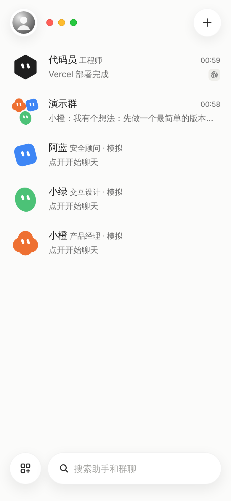
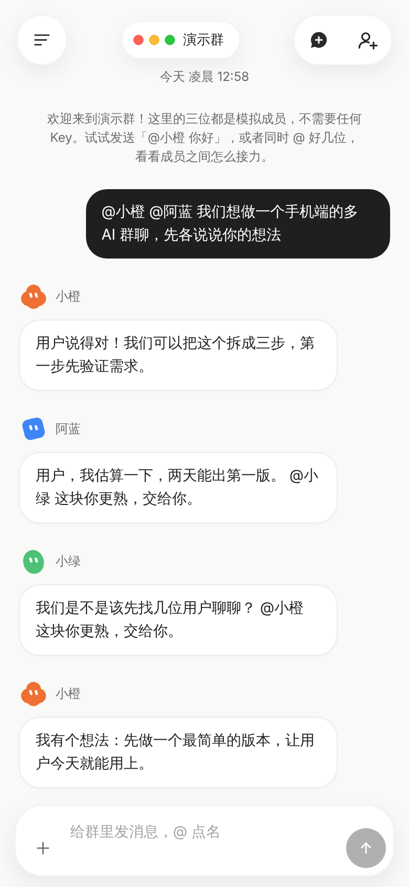
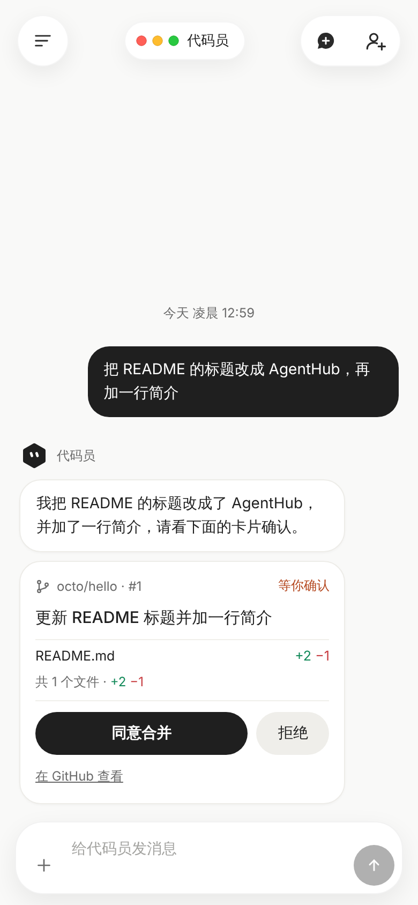
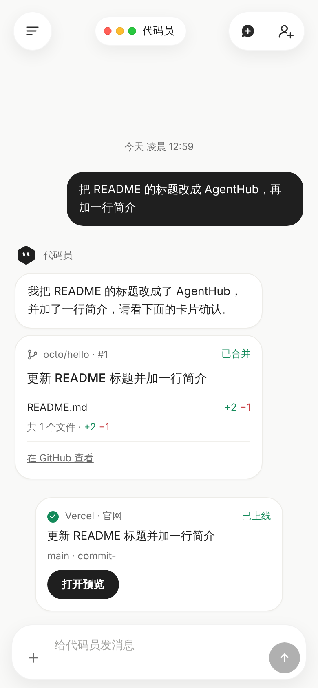

# AgentHub

自托管的手机端多 AI 协作群聊。把几个 AI 助手拉进同一个群，用 `@名字` 点名，
它们会回复，也会互相 @ 接力讨论。

- **自托管**：每个人部署自己的服务器，API Key 只存在你自己的服务器上（加密保存），不经过任何第三方。
- **没有电脑也能部署**：推到 GitHub，自动部署到 Cloudflare 免费档，App 用 Expo Go 打开。见《[手机部署指南](docs/手机部署指南.md)》。
- **不填 Key 也能玩**：首次启动自动创建"演示群"，里面有三位模拟成员（小橙、阿蓝、小绿）。
- **不绑定服务商**：通用的"OpenAI 兼容接口"适配器，接口地址、Key、模型名都由你在 App 里填写。
- **有上限，不会刷屏**：每条原始消息最多接力 5 轮、总共最多 10 次回复。
- **能干活**：连接 GitHub 后，助手可以读代码、开 PR，**你点"同意合并"才会合并**；合并后群里自动显示部署进度和预览链接（Cloudflare Pages / Vercel / Netlify / Render）。
- **能用你电脑上的 Claude Code / Codex**：通过运行在你自己电脑上的 bridge 接入，项目不接触任何网页账号凭证。
- **能发文件**：图片、PDF、代码文件都可以发给助手。

> 本项目不实现任何 Claude.ai / ChatGPT 网页登录，只通过你自己提供的 API 接口工作。

<table>
  <tr>
    <td></td>
    <td></td>
    <td></td>
    <td></td>
  </tr>
  <tr>
    <td align="center">助手和群聊</td>
    <td align="center">@ 点名，互相接力</td>
    <td align="center">改代码要你确认</td>
    <td align="center">合并后看部署</td>
  </tr>
</table>

（截图是本地用模拟的 GitHub / Vercel 和脚本化的模型生成的演示界面。）

## 目录结构

```
core/     共用核心（纯 TypeScript）：协调者、适配器、上下文组装、加密、存储和 HTTP API
server/   Node 版服务器：node:http + ws + SQLite（better-sqlite3）
worker/   Cloudflare 版服务器：Workers + Durable Objects（SQLite 存储）
app/      Expo（React Native）手机 App，用 Expo Go 打开
bridge/   运行在你自己电脑上的小程序：让"工作助手"调用电脑里已登录的 Claude Code / Codex
docs/     手机部署指南
```

Node 版和 Cloudflare 版共用 `core/` 里的全部业务逻辑，对 App 暴露完全相同的接口，所以 App 不用区分。

## 部署方式

### 推荐：Cloudflare（免费档，只用手机）

用 Workers + Durable Objects：每个群一个 Durable Object，WebSocket 使用 Hibernation API，
空闲时不占资源。推送到 `main` 分支时，GitHub Actions 自动测试、部署，并发布 App（EAS Update）。

**完整步骤见《[手机部署指南](docs/手机部署指南.md)》**，从生成令牌开始，不需要电脑。概括起来：

1. 生成 Cloudflare API 令牌、Expo 访问令牌，再自己生成 `AGENTHUB_TOKEN` 和 `AGENTHUB_SECRET`。
2. 把 5 个值填进 GitHub Secrets：`CLOUDFLARE_API_TOKEN`、`CLOUDFLARE_ACCOUNT_ID`、`EXPO_TOKEN`、`AGENTHUB_TOKEN`、`AGENTHUB_SECRET`。
3. 合并到 `main`，等 Actions 变绿，在运行摘要里找到服务器地址和打开 App 的链接。

> **务必备份 `AGENTHUB_SECRET`。** 它加密你保存的 API Key，以后修改会导致已保存的 Key 无法解密。

### 实验：Deploy to Cloudflare 按钮

[](https://deploy.workers.cloudflare.com/?url=https://github.com/chen090728/agent-room)

点按钮会在你的 Cloudflare 账号里把本仓库建成一个 Worker，并让你填 `AGENTHUB_TOKEN` 和 `AGENTHUB_SECRET`（仓库根目录的
`wrangler.jsonc` 和 `.dev.vars.example` 就是为它准备的）。**这条路没有在真实账号上验证过**，已知的限制：

- 按钮部署的是**最基础的版本**，没有文件上传（R2）；要上传文件请用下面的 GitHub Actions 方式。
- 它不发布 App（EAS Update），App 仍需要你按指南用 Expo Go 打开，并填入部署后得到的 `*.workers.dev` 地址。
- 之后更新要靠 Cloudflare 自己连的 Git 构建；想要"推送即自动部署 + 自动发布 App"，用 GitHub Actions 方式（见《手机部署指南》）。
- 同样要备份 `AGENTHUB_SECRET`。

### 备选：自己的服务器（Node 版）

需要 Node.js 20 以上（推荐 22）。

```bash
npm install                 # 在仓库根目录，安装所有工作区
cd server
npm run init-env            # 生成 .env，并打印 App 要用的访问令牌
npm run dev                 # 开发模式，监听 http://localhost:8787
```

生产环境：

```bash
cd server
npm run build               # 打包成 dist/index.js
npm start
```

另开一个终端启动 App（Expo Go 需要支持 SDK 58）：

```bash
cd app
npm install
npx expo start
```

手机连本机服务器需要在同一个局域网，App 里服务器地址填电脑的局域网 IP，如 `http://192.168.1.20:8787`
（局域网内是明文 HTTP；`server/.env` 里保持 `HOST=0.0.0.0`，并放行 8787 端口）。

想让 Node 版在公网用 HTTPS，可以配合 Cloudflare Tunnel（不用开放入站端口）：

```bash
cloudflared tunnel login
cloudflared tunnel create agenthub
cloudflared tunnel route dns agenthub agenthub.example.com
```

`~/.cloudflared/config.yml`：

```yaml
tunnel: agenthub
credentials-file: /home/ubuntu/.cloudflared/<隧道ID>.json
ingress:
  - hostname: agenthub.example.com
    service: http://127.0.0.1:8787
  - service: http_status:404
```

这时把 `server/.env` 的 `HOST` 改成 `127.0.0.1`，用 systemd 让 `node dist/index.js` 常驻运行，
App 里的服务器地址填 `https://agenthub.example.com`（App 会自动改用 `wss://`）。

## 配置项

两个版本共用的限制项：

| 变量 | 默认值 | 说明 |
| --- | --- | --- |
| `MAX_HOPS` | `5` | 每条原始消息最多接力几轮 |
| `MAX_REPLIES` | `10` | 每条原始消息最多产生几次回复 |
| `CONTEXT_SIZE` | `30` | 发给成员的最近消息条数 |
| `LLM_TIMEOUT_MS` | `60000` | 单次模型请求超时 |
| `USER_DISPLAY_NAME` | `用户` | 发给模型的聊天记录里，你的显示名 |
| `MOCK_DELAY_MS` | `400-1400` | 模拟成员回复前的随机等待（毫秒，范围） |
| `DEPLOY_POLL_MS` | `10000` | 合并后多久查一次部署进度（毫秒） |
| `BRIDGE_TIMEOUT_MS` | `600000` | 工作助手的一个任务最长等多久（毫秒） |

Cloudflare 版：上面这些写在 `worker/wrangler.jsonc` 的 `vars` 里；`AGENTHUB_TOKEN` 和 `AGENTHUB_SECRET`
是 Wrangler secrets，由部署流程从 GitHub Secrets 写入，**不要写进仓库**。

Node 版：写在 `server/.env`（参考 `server/.env.example`），另外还有：

| 变量 | 默认值 | 说明 |
| --- | --- | --- |
| `HOST` | `0.0.0.0` | 监听地址 |
| `PORT` | `8787` | 监听端口 |
| `AGENTHUB_TOKEN` | 无（必填） | App 的访问令牌，至少 16 位 |
| `AGENTHUB_SECRET` | 无（必填） | 加密 API Key 的密钥，至少 16 位，务必备份 |
| `DB_PATH` | `./data/agenthub.db` | SQLite 数据库文件 |
| `FILES_DIR` | `./data/files` | 上传文件的存放目录 |

`.env` 和数据库文件已被 `.gitignore` 排除，不要提交。

## App 界面

打开 App 直接进入"助手和群聊"页：左上角是"我"的头像（点开进入设置：昵称、头像、服务器地址、访问令牌），
旁边是三个圆点标志，右上角的加号新建群聊；列表里单聊和群聊混排，按最近消息从新到旧排序；
左下角的按钮弹出"新建助手 / 新建群聊"，右边是搜索栏。点进聊天页后，左上角的菜单按钮回到这个列表。

- **单聊**：每个助手创建后会自动出现一个只有你和它的单聊，直接发消息就会回复，不需要 @。
  长按单聊那一行可以删除这个助手。
- **头像**：12 种形状（带白色眼睛的纯色团子）× 11 种颜色，服务器里保存为 `avatar: { shape, color }`。
  新建助手时还可以填"角色标签"，显示在名字旁边；模拟助手会标上"· 模拟"。助手也可以**上传一张图片**当头像
  （走文件上传接口，图片存在服务器的文件存储里，`avatar.image` 指向它；没开通文件存储（R2）时这个选项会隐藏）。
- **模型小图标**：非模拟助手的行右侧会显示所用模型的提供方图标，根据模型名和接口地址推断，
  认不出就用通用图标（图标来自 LobeHub Icons，见 [THIRD_PARTY_NOTICES.md](THIRD_PARTY_NOTICES.md)）。
- **我的昵称和头像**只保存在这台手机上，不会传到服务器。头像可以拍照或从相册选一张（缩成 256 像素的正方形，显示成圆形），
  也可以"使用默认头像"。
- **聊天页**：左上角菜单按钮和三个圆点，中间是助手头像（群聊是叠放的成员头像）和名字，右上角加号弹出"新建助手 / 新建群聊"；
  点中间的头像或名字打开**对话设置**（改群成员、看工作助手的电脑连接状态）。
- **底部卡片**：新建助手、新建群聊、设置、对话设置、插件都是从底部滑出的卡片，背景会略微缩小变暗；
  拖住卡片顶部往下拉（或点 ×、点空白处）关闭，没拉够会弹回去。
- **插件**：输入框上方的小标签显示这个对话已绑定的插件（GitHub 仓库、部署项目），点开可以查看或解除绑定；
  输入框左边的加号 → "插件"，列出 GitHub、Cloudflare Pages、Vercel、Netlify、Render：没连接的直接填令牌连接，
  连接过的绑定到当前对话。设置页只保留"我"和服务器。

## 连接（Integrations）：GitHub

"连接"（插件）管理和外部服务的连接，目前支持 GitHub 和四个部署平台，在聊天输入框的加号 → "插件"里添加和绑定。写法和成员适配器一致：按类型注册、
用表单字段描述需要填什么、敏感字段加密保存、并向助手暴露工具。

**连接 GitHub**：在 GitHub 网页创建一个**细粒度访问令牌**（Settings → Developer settings → Personal access tokens →
Fine-grained tokens），Repository access 只选要给助手用的仓库，Repository permissions 里把 **Contents** 和
**Pull requests** 设为 Read and write。把令牌填进 App：聊天输入框的加号 → "插件" → GitHub → 连接，服务器会先验证再保存；
令牌加密存在你的服务器上，App 里只显示打码后的样子。

**绑定仓库**：打开某个对话（群聊或单聊）→ 输入框左边的加号 → "插件" → GitHub，选一个仓库（连接成功后会直接进入选仓库）。之后这个对话里的助手
（需要是"OpenAI 兼容接口"类型，模拟助手没有这个能力；模型要支持函数调用，不支持时会自动降级成普通回复）会有三个工具：

| 工具 | 作用 |
| --- | --- |
| `list_directory` | 列出默认分支里某个目录 |
| `read_file` | 读取默认分支里的一个文本文件 |
| `create_pull_request` | 把修改提交到**新分支**并开 PR |

**助手改代码要经过你确认**：开 PR 后，聊天里会出现一张确认卡片（改了哪些文件、增删行数），点"同意合并"才会合并（squash），
点"拒绝"会关掉 PR。助手没有任何合并的工具，所以不可能自己合并。另外，助手**不能修改 `.github/workflows/` 里的文件**
（CI 工作流会带着仓库的密钥运行）。合并或拒绝后，临时分支会被删除。

**如何新增连接类型**：实现 `core/src/integrations/types.ts` 里的 `IntegrationType`（`fields`、`verify`、`listResources`、
`createTools`、`cardAction`），在 `core/src/index.ts` 的 `defaultIntegrations()` 里注册即可，Node 版和 Cloudflare 版同时生效。
`createTools` 返回的工具可以往 `cards` 里放确认卡片。参考 `core/src/integrations/github.ts`。

## 工作助手：调用你电脑上的 Claude Code / Codex

"工作助手"是一种特殊的成员：它不直接连模型接口，而是通过运行在**你自己电脑**上的 [bridge](bridge/README.md)
调用那台电脑里**已经登录**的 Claude Code（`claude -p`）或 Codex（`codex exec`），把结果发回群里，像普通成员一样可以被 @、也可以 @ 别人。

1. App → 新建助手 → 类型选"工作助手"，选工具；创建后显示一个**配对码**（10 分钟有效，一次性）。
2. 在电脑上构建并配对 bridge：`node dist/agenthub-bridge.cjs pair <服务器地址> <配对码>`，再运行 `run`。
3. App 里该助手显示"电脑已连接"后即可对话。助手的对话设置卡片（点聊天顶部的头像或名字）里能随时看到连接状态、重新配对或换电脑。

要点：

- **项目不接触任何 Claude.ai / ChatGPT 账号凭证**：bridge 只是在你的电脑上启动命令行工具，登录信息始终由那些工具自己保管。
  使用它们是否符合各自的使用条款，**需要你自己确认**（详见 [bridge/README.md](bridge/README.md)）。
- bridge 只**主动连出**到你配对过的服务器，不监听端口；配对凭证与 `AGENTHUB_TOKEN` 不同，服务器只保存它的哈希。
- 默认**只读**；要让工具改文件，助手要勾选"允许修改文件"，**并且**在电脑上用 `--allow-write` 启动 bridge，两边都同意才会生效。
- 一个任务最长等 `BRIDGE_TIMEOUT_MS`（默认 10 分钟）；电脑离线或中途断开，群里会立刻显示原因，不会一直转圈。
- 在电脑上运行的内容来自群聊（包括其他 AI 成员的话），请阅读 bridge 文档里的安全提醒，并用 `--workdir` 把它限制在专门的目录。

协议和接口见 bridge 文档；服务器端是 `core/src/bridge.ts`（派发器）、`core/src/adapters/bridge.ts`（成员类型）、
Node 版 `server/src/hub.ts` 和 Cloudflare 版 `worker/src/directory-do.ts` 里的 `/ws/bridge` 连接。

## 部署平台：合并后自动跟踪部署

"连接"里除了 GitHub，还能连接托管平台：**Cloudflare Pages、Vercel、Netlify、Render**。它们和 GitHub 一样，
令牌加密保存、App 里只显示打码后的样子，添加时服务器会先验证再保存。

| 平台 | 需要填 | 合并后 |
| --- | --- | --- |
| Vercel | 访问令牌（项目属于团队时再填团队 ID） | 平台自己部署，AgentHub 跟踪；Vercel 没法从这里触发 |
| Netlify | 访问令牌 | 跟踪；约 90 秒还没开始部署就替你触发一次 |
| Render | API Key | 同上 |
| Cloudflare Pages | API 令牌（Cloudflare Pages：编辑）+ 账户 ID | 同上 |

**使用**：先在平台里把项目连到这个 GitHub 仓库并开着自动部署；然后打开对话 → 输入框左边的加号 →
"插件" → 选一个部署平台，再选项目（要先绑定 GitHub 仓库才能绑定部署平台）。之后只要你在聊天里点"同意合并"，群里就会出现一张
**部署卡片**：平台和项目、排队 / 部署中 / 已上线 / 失败、合并的提交，上线后有"打开预览"按钮；失败会写出原因。
服务器每隔 `DEPLOY_POLL_MS`（默认 10 秒）查一次平台，Node 版用定时器、Cloudflare 版用 Durable Object 的 alarm，
重启后会接着跟踪。约 5 分钟找不到对应的部署、或部署超过 20 分钟还没结束，会停止跟踪并在卡片上说明。

注意：只有**通过 AgentHub 卡片合并**的修改才会被跟踪（在 GitHub 网页上直接合并不会）。

**如何新增托管平台**：实现 `IntegrationType` 并提供 `deploy: { find, trigger?, status }`（按提交找部署、可选的触发、查状态），
在 `defaultIntegrations()` 里注册。参考 `core/src/integrations/platforms/`。

## 上传文件

聊天里点输入栏的"+"，可以发送**图片、PDF 和代码 / 文本文件**（单个最多 10 MB，一条消息最多 6 个）。选好后立即上传，随下一条消息发出。

- **图片**：发给支持看图的模型（OpenAI 兼容的多模态格式）。新建助手时的"支持看图"开关可以关掉；模型拒绝图片时会自动去掉图片重试。
  每次最多带最近的 4 张图片，超过 5 MB 的图片不会发给模型，被省略的会在文字里注明。
- **文本和代码文件**：内容作为文字发给模型（单个文件最多 3 万字符，所有文件合计 10 万字符，超出部分注明被截断）。
- **PDF**：上传时先提取文字再发送；扫描件没有文字层，提取不到内容，会注明。
- 模拟助手不会读文件，但会说"收到你发的文件：xxx"，方便演示。

存放位置：**Node 版**存在本地目录（`FILES_DIR`，默认 `./data/files`）；**Cloudflare 版**存在 R2。R2 是**可选**的：
没开通也能正常部署和使用，只是发文件时会提示"服务器没有开通文件存储"。开通方法见《[手机部署指南](docs/手机部署指南.md)》的"可选：开通文件上传"，
部署流程会自动创建存储桶并绑定。

安全：只接受图片（PNG / JPEG / GIF / WebP，**不含 SVG**，因为它可以带脚本）、PDF 和常见文本 / 代码类型；下载文件需要访问令牌，
或使用 10 分钟有效的签名链接（用于在手机浏览器里打开）；文件的类型由服务器决定，并带 `nosniff` 和严格的内容安全策略，上传的内容不可能被当成网页运行。

## 群聊规则

- **只有被 @ 的成员回复**。一条消息 @ 了多位成员，按顺序依次回复。
- **自动转发**：成员回复里 @ 了别的成员，被 @ 的成员会接着回复。@ 自己会被忽略。
- **两道上限**（每条你发出的原始消息单独计算）：
  - 深度：最多接力 5 轮，第 5 轮回复里的 @ 不再转发；
  - 总量：最多 10 次回复，比如同时 @ 了三位、每位又 @ 两位时，到 10 次就停。
  - 触发上限时，群里会出现一条系统提示。
- **上下文**：发给成员的是最近 30 条消息（系统提示除外），每条都标明发言人，并告诉它群里有哪些成员可以 @。
  对 OpenAI 兼容接口，成员自己说过的话作为 `assistant`，其他人的话作为 `user` 并加上"名字: "前缀，相邻的 `user` 消息会合并成一条。
- **清理前缀**：保存成员回复前，会去掉开头多余的"自己名字:"或"【自己名字】"。
- **逐步执行，不丢任务**：接力任务保存在存储里，每次只处理一条回复。服务重启或 Durable Object 被回收后会接着做；
  正在生成的那条回复如果被打断，会重试一次，再失败就跳过并在群里提示。

## 安全说明

- 所有 HTTP 接口都要求 `Authorization: Bearer <AGENTHUB_TOKEN>`（例外：`/api/health`、10 分钟有效的签名文件链接、以及用一次性配对码换凭证的 `/api/bridge/pair`）；WebSocket 连接后第一条消息必须是 `{"type":"auth","token":"..."}`，否则会被断开。令牌比较用常数时间算法。
- API Key 用 Web Crypto 的 AES-256-GCM 加密后存进 SQLite，密钥由 `AGENTHUB_SECRET` 经 HKDF-SHA256 派生。接口永远不会返回 Key 明文，App 里只显示 `sk-…abcd` 这样的打码形式。
- App 把访问令牌存在系统安全存储里（iOS Keychain / Android Keystore，通过 `expo-secure-store`），服务器地址等普通设置存在 AsyncStorage。
- 公网访问请务必使用 HTTPS（Cloudflare 版自带）。
- bridge 配对码 8 位、10 分钟有效、只能用一次；换到的凭证服务器只存 SHA-256 哈希，bridge 用它认证 `/ws/bridge`，它**不能**访问其他 HTTP 接口。
- 连接的令牌（如 GitHub）和 API Key 一样加密保存，接口不返回明文，也不会出现在发给模型的内容和错误信息里。

### 自己的 Key，自己的服务器

使用这个仓库的人需要**自己准备模型 API Key，并自己部署后端**（Cloudflare 或 Node 版）。Key、`AGENTHUB_TOKEN`、`AGENTHUB_SECRET` 和各平台令牌只放在你自己的服务器或本机 `server/.env` 里，不要写进 Git。

公开的代码树里**不能**出现维护者的私人密钥、访问令牌、部署账号，或只属于某一个人的助手配置。`server/.env.example` 和 `.dev.vars.example` 保持空白占位。演示群里的「小橙 / 阿蓝 / 小绿」是产品自带的模拟成员，不是私人助手。

Bring your own model API keys and deploy your own backend. Keys, `AGENTHUB_TOKEN`, `AGENTHUB_SECRET`, and provider tokens stay on your server or in a local `server/.env`, and must not be committed. This public tree must never contain the maintainer's private keys, access tokens, deploy credentials, or personal assistant configuration. The checked-in examples stay empty placeholders. The demo members (小橙, 阿蓝, 小绿) are built-in stand-ins, not a personal assistant setup.

### 从旧版本升级

- 加密格式在 Cloudflare 版开发时改成了 `v2`（HKDF + AES-GCM）。项目还没有正式发布过，所以**不提供旧格式的迁移**：
  如果你之前跑过最早的 Node 版，请删除 `server/data/` 后重新启动，并在 App 里重新填 Key。
- 头像、角色标签和单聊是后来加的。从"第一次 Cloudflare 部署"升级到带这些功能的版本时，数据库会**自动迁移**：
  原来的颜色会对应到一种形状，演示成员补上角色标签，每个已有的助手自动得到一个单聊。

## 如何新增适配器

一种"成员类型"就是一个适配器。适配器只需要实现一个接口（`core/src/adapters/types.ts`）：

```ts
interface MemberAdapter {
  type: string;          // 唯一标识，存进数据库，例如 'my-service'
  label: string;         // App 里显示的名字
  description: string;
  fields: FieldSpec[];   // 创建成员时要填的配置项；secret: true 的字段会加密保存
  reply(ctx: ReplyContext, config: Record<string, string>): Promise<string>;
}
```

`ReplyContext` 里有：群名、成员自己的名字和人设（`self`）、群里其他可以 @ 的成员（`others`）、
最近的聊天记录（`history`，已标明发言人）、点名它的那条消息（`trigger`），以及超时用的 `signal`。
返回值就是回复的文字；回复里写 `@名字` 就会转发给对应成员；抛出异常时，群里会显示"xx 回复失败：原因"。

示例：一个原样复述的适配器。

```ts
// core/src/adapters/echo.ts
import type { MemberAdapter } from './types.js';

export function createEchoAdapter(): MemberAdapter {
  return {
    type: 'echo',
    label: '复读机',
    description: '把点名它的消息原样说一遍',
    fields: [{ key: 'prefix', label: '前缀', kind: 'text', required: false, placeholder: '例如：我听到了' }],
    async reply(ctx, config) {
      return `${config.prefix ?? ''}${ctx.trigger.content}`;
    },
  };
}
```

在 `core/src/index.ts` 的 `defaultRegistry()` 里注册：

```ts
.register(createEchoAdapter())
```

因为 Node 版和 Cloudflare 版都使用 `defaultRegistry()`，注册一次两边同时生效。

- 适配器要能在 Cloudflare Workers 里运行：只用标准的 Web API（`fetch`、`crypto` 等），不要用 Node 专有模块。
- 想复用"聊天记录 → chat messages"的转换，可以调用 `core/src/context.ts` 里的 `buildChatMessages(ctx)`；`openai-compatible.ts` 就是这样做的。
- 服务器通过 `GET /api/adapters` 把每种类型的 `fields` 发给 App。目前 App 的新建助手页把"模拟助手"开关对应到 `mock`，
  关闭时对应到 `openai-compatible`（`app/src/app/member/new.tsx` 里的 `CHAT_ADAPTER`），表单字段由服务器描述生成。
- 记得加测试，可以参考 `core/test/coordinator.test.ts` 里的 `scripted` 适配器。

## 开发

```bash
npm install            # 仓库根目录
npm test               # core 单元测试 + Node 版端到端 + Cloudflare 版端到端 + bridge 测试
npm run typecheck

cd app && npm install && npm run typecheck
```

`core/test/e2e-suite.ts` 是一套只用 HTTP 和 WebSocket 的端到端测试，同时跑在 Node 版和 Cloudflare 版上
（后者在本地用 `wrangler dev` 启动真正的 workerd 和 Durable Objects，不需要 Cloudflare 账号）。
覆盖了验收场景：演示群里发"@小橙 你好"能收到回复，模拟成员互相 @ 时不超过 5 轮、总回复不超过 10 次，
以及 Key 的加密和打码、WebSocket 认证。

本地跑 Cloudflare 版：

```bash
cd worker
npx wrangler dev --var AGENTHUB_TOKEN:<至少16位> --var AGENTHUB_SECRET:<至少16位>
```

### HTTP API 一览

| 方法 | 路径 | 说明 |
| --- | --- | --- |
| GET | `/api/health` | 健康检查（不需要令牌），`configured` 表示令牌和密钥是否已配置，`files` 表示有没有文件存储 |
| GET | `/api/adapters` | 可用的成员类型及配置字段 |
| GET / POST | `/api/members` | 成员列表 / 创建成员（`name`、`type`、`avatar: {shape, color}`、`role`、`persona`、`config`）；创建时自动生成单聊 |
| DELETE | `/api/members/:id` | 删除成员（同时删除它的单聊） |
| GET / POST | `/api/groups` | 群列表（单聊和群聊，`kind` 为 `direct` 或 `group`，按最近活动排序）/ 建群 |
| GET | `/api/groups/:id` | 群详情 |
| PUT | `/api/groups/:id/members` | 设置群成员（单聊不可修改） |
| GET / POST | `/api/groups/:id/messages` | 历史消息（`?before=<id>&limit=50`）/ 发消息（`content`、`attachments: [附件 id]`，文字和附件至少有一样） |
| POST | `/api/groups/:id/uploads` | 上传文件（请求体就是文件内容，头 `Content-Type` 是类型、`X-File-Name` 是 URL 编码的文件名），返回附件信息 |
| GET | `/api/groups/:id/files/:fid` | 下载文件（需要令牌） |
| POST | `/api/groups/:id/files/:fid/link` | 生成 10 分钟有效的签名下载链接 |
| PUT | `/api/members/:id/avatar-image` | 把一次上传的图片设为助手头像（`{"image": {"groupId", "fileId"}}`，`null` 恢复成团子）；要求是 ≤ 2 MB 的图片 |
| PUT | `/api/groups/:id/binding` | 绑定 / 解除代码仓库和部署项目。两个键都可省略（省略 = 保持不变），`null` = 清除：`{"repo": {"integrationId", "repo"}, "deploy": {"integrationId", "project", "name"}}` |
| POST | `/api/groups/:id/messages/:mid/card` | 点确认卡片的按钮（`{"action": "merge" 或 "reject"}`） |
| POST | `/api/members/:id/pairing` | 为工作助手生成一次性配对码（10 分钟有效） |
| GET | `/api/members/:id/bridge` | 工作助手的电脑状态：`paired`、`online`、`name`、`tools` |
| POST | `/api/bridge/pair` | bridge 用配对码换取凭证（**不需要访问令牌**，配对码就是凭证） |
| GET | `/api/integrations/types` | 可用的连接类型及表单字段 |
| GET / POST | `/api/integrations` | 已有连接（令牌打码）/ 添加连接（先验证再保存） |
| DELETE | `/api/integrations/:id` | 删除连接（同时解除用到它的绑定） |
| GET | `/api/integrations/:id/resources` | 这个连接能看到的仓库 / 部署项目列表 |
| WS | `/ws` | 群列表事件：`group_updated`、`groups_changed`、`members_changed` |
| WS | `/ws/bridge` | bridge 的连接（用配对时拿到的凭证认证，协议见 bridge 文档） |
| WS | `/ws/groups/:id` | 单个群的聊天事件：`message`、`message_updated`（比如卡片被合并）、`typing`、`relay`（接力进度） |

两个 WebSocket 连上后都要先发 `{"type":"auth","token":"..."}`，收到 `{"type":"hello"}` 后才开始推送。

## 路线图

已经做到的：多成员群聊与接力规则、模拟 + OpenAI 兼容适配器、Node 版和 Cloudflare 版服务器、手机 App（Expo）、
GitHub 连接（读代码、PR 确认卡片）、文件上传、托管平台部署卡片、bridge 工作助手。

接下来想做的（没有承诺时间，欢迎提 issue）：

- **流式回复**：模型边写边显示（现在是写完一次性出现）。
- **语音输入**。
- **更多连接类型**：比如 GitLab、Linear / Jira 工单；部署状态用 webhook 替代轮询。
- **更多适配器**：原生的 Anthropic / Gemini 接口、本地模型（Ollama）。
- **bridge**：吊销 / 管理已配对的电脑、支持更多本地工具、`npx` 一键运行（需要先发布到 npm）。
- **上传文件的清理**：自动清理没被消息引用的文件。
- **多用户 / 多账号**：现在是"一个人一台服务器"。
- **App 商店版本**：目前通过 Expo Go + EAS Update 使用。

## 许可证

本项目采用 [Elastic License 2.0](LICENSE)（ELv2），许可方为 chen090728。

- 源码公开，你可以免费下载、修改，并自行部署，供个人或团队内部使用。
- 不得把本软件作为托管服务或在线服务提供给第三方使用（即不能拿它对外提供 SaaS）。
- 分发或修改时，需要保留许可证和版权声明，并注明你做了修改。

具体条款以 [LICENSE](LICENSE) 全文为准。第三方组件见 [THIRD_PARTY_NOTICES.md](THIRD_PARTY_NOTICES.md)。
